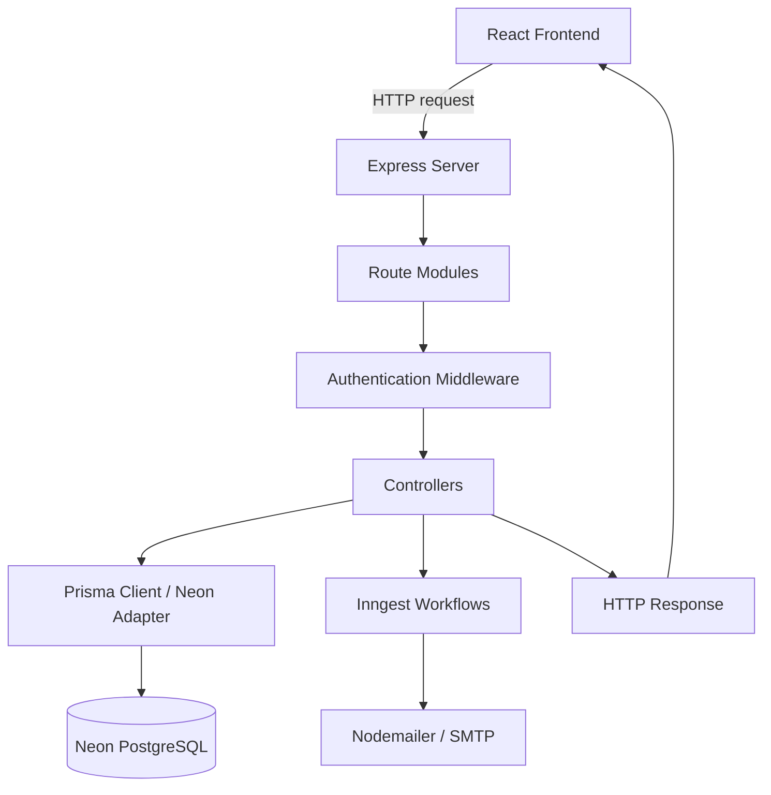

<div align="center">

# Project Management System — Backend

**REST API and server-side services for project, task, workspace, and team collaboration workflows.**

[](https://nodejs.org/)
[](https://expressjs.com/)
[](https://www.prisma.io/)
[](https://neon.tech/)
[](https://clerk.com/)
[](https://www.inngest.com/)

</div>

---

## Overview

This directory contains the backend for the **Project Management System**. It is a Node.js application using Express 5 to expose server-side functionality for projects, tasks, workspaces, and comments.

The backend integrates Clerk for authentication, Prisma ORM for database access, Neon PostgreSQL as the database service, Inngest for event-driven background workflows, and Nodemailer for SMTP email delivery. Its code is organized into route modules, controllers, middleware, configuration modules, and a Prisma schema.

This README describes the structure and configuration represented by the repository. Exact endpoint paths, permissions, data models, and background-job behavior should be verified in the implementation before being treated as an API contract.

---

# 👨‍💻 About Me

Hi, I'm **Satinder Singh Sall**, a Full-Stack Developer, AI Enthusiast, and MCA student passionate about building scalable digital products, intelligent software systems, and meaningful user experiences.

My journey spans across **Web Development, Mobile Applications, Artificial Intelligence, Cloud Technologies, and Creative Writing**. I enjoy transforming ideas into production-ready solutions using modern technologies while continuously exploring emerging fields like Machine Learning, Computer Vision, and Automation.

Currently, I'm pursuing my **Master of Computer Applications (MCA)** while actively developing full-stack applications, AI-powered solutions, and open-source learning resources. My work focuses on creating software that is not only functional but also scalable, maintainable, and impactful.

## 🚀 What I'm Building

- 🤖 AI-Powered Attendance System using Face Recognition & Voice Biometrics
- 🌐 Modern Full-Stack Web Applications
- 📱 Cross-Platform Mobile Applications
- 🎮 Exploring Game Development & Interactive Experiences
- 📚 Open-Source Learning Roadmaps and Technical Resources
- ✍️ Satinder Poetry — A platform for original poetry, essays, and creative writing

## 🛠️ Core Technologies

**Frontend:** React, Next.js, TypeScript, Tailwind CSS
**Backend:** Node.js, Express.js, REST APIs
**Databases:** MongoDB, PostgreSQL, MySQL, Firebase, Supabase
**DevOps & Cloud:** Docker, GitHub Actions, Vercel, Render
**Programming:** Python, Java, JavaScript, C++, C#, Kotlin
**AI / ML:** Python, Computer Vision, Face Recognition, Automation
**Mobile Apps:** High-Performance Android, iOS, Cross-Platform & Native Development

## 🌍 Connect With Me

🌐 Portfolio: https://satinder-portfolio.vercel.app

💻 GitHub: https://github.com/SatinderSinghSall

💼 LinkedIn: https://www.linkedin.com/in/satinder-singh-sall-b62049204/

🎥 YouTube: https://www.youtube.com/@satindersinghsall.3841

✍️ Satinder Poetry: https://satinderpoetry.com

🤖 AI Attendance Project: https://ai-attendance-app-satinder.vercel.app/

---

> _"I believe great software is built at the intersection of engineering excellence, continuous learning, creativity, and real-world problem solving."_

⭐ Always learning. Always building. Always improving.

---

## Responsibilities

- Handle HTTP requests from the frontend.
- Organize API endpoints by domain.
- Apply authentication middleware where configured.
- Implement project, task, workspace, and comment operations in controllers.
- Access PostgreSQL through Prisma and the configured Neon adapter.
- Integrate event-driven background processing with Inngest.
- Configure SMTP email delivery with Nodemailer.
- Load environment-specific settings without committing credentials.

## Technology Stack

| Technology                 | Role                                          |
| -------------------------- | --------------------------------------------- |
| Node.js                    | JavaScript runtime                            |
| Express 5                  | HTTP server and routing                       |
| Clerk Express              | Server-side authentication integration        |
| Prisma 6                   | ORM, schema management, and client generation |
| Neon PostgreSQL            | Hosted relational database                    |
| `@neondatabase/serverless` | Neon serverless database driver dependency    |
| `@prisma/adapter-neon`     | Prisma adapter for Neon                       |
| Inngest                    | Event-driven functions and background jobs    |
| Nodemailer                 | SMTP email delivery                           |
| `dotenv`                   | Environment variable loading                  |
| CORS                       | Cross-origin request configuration            |
| Multer                     | Multipart form-data handling                  |
| `ws`                       | WebSocket implementation dependency           |
| Nodemon                    | Automatic server restart during development   |

## Architecture

### High-level request flow



The diagram represents the major integrations and an intended high-level flow. The exact middleware order and whether a controller invokes Inngest or email depend on the implementation.

### Backend layers

- **Server entry point (`server.js`):** application setup, middleware registration, route mounting, and server startup.
- **Routes (`routes/`):** group endpoints by application domain.
- **Controllers (`controllers/`):** process requests and implement business operations.
- **Middleware (`middlewares/`):** reusable request processing, including authentication.
- **Configuration (`configs/`):** database and mailer setup.
- **Prisma (`prisma/`):** database schema and model definitions.
- **Inngest (`inngest/`):** background-function definitions and event-driven work.
- **Deployment (`vercel.json`):** deployment-platform configuration.

## Repository Structure

```text
server/
├── configs/
│   ├── nodemailer.js
│   └── prisma.js
├── controllers/
│   ├── commentController.js
│   ├── projectController.js
│   ├── taskController.js
│   └── workspaceController.js
├── inngest/
│   └── index.js
├── middlewares/
│   └── authMiddleware.js
├── prisma/
│   └── schema.prisma
├── routes/
│   ├── commentRoutes.js
│   ├── projectRoutes.js
│   ├── taskRoutes.js
│   └── workspaceRoutes.js
├── .env.example
├── package-lock.json
├── package.json
├── server.js
└── vercel.json
```

## Prerequisites

- A compatible Node.js LTS release.
- npm.
- A Clerk application for authentication.
- A Neon PostgreSQL database.
- Inngest credentials and configuration if background workflows are used.
- SMTP credentials if email delivery is used.

Verify your local tools:

```bash
node --version
npm --version
```

## Installation

From the `server/` directory:

```bash
npm install
```

For reproducible installation using the committed lockfile:

```bash
npm ci
```

The package defines a `postinstall` script that runs `prisma generate`. If client generation fails, review the Prisma schema and datasource/adapter configuration, then run the generation command manually.

## Environment Configuration

Create a local `.env` file from the committed example.

**Windows Command Prompt:**

```bat
copy .env.example .env
```

**macOS / Linux / Git Bash:**

```bash
cp .env.example .env
```

Configure the values in `server/.env`:

```dotenv
NODE_ENV=development

# Clerk
CLERK_PUBLISHABLE_KEY=your_clerk_publishable_key
CLERK_SECRET_KEY=your_clerk_secret_key

# Neon PostgreSQL
DATABASE_URL=your_neon_pooled_connection_url
DIRECT_URL=your_neon_direct_connection_url

# Inngest
INNGEST_EVENT_KEY=your_inngest_event_key
INNGEST_SIGNING_KEY=your_inngest_signing_key

# SMTP / email
SENDER_EMAIL=your_sender_email
SMTP_USER=your_smtp_username
SMTP_PASS=your_smtp_password
```

| Variable                | Purpose                                                                  |
| ----------------------- | ------------------------------------------------------------------------ |
| `NODE_ENV`              | Indicates the runtime environment, such as `development` or `production` |
| `CLERK_PUBLISHABLE_KEY` | Public Clerk application key where needed by server configuration        |
| `CLERK_SECRET_KEY`      | Secret key for server-side Clerk integration                             |
| `DATABASE_URL`          | Neon pooled connection URL, if the Prisma configuration uses pooling     |
| `DIRECT_URL`            | Direct Neon connection URL, if required by the Prisma schema or workflow |
| `INNGEST_EVENT_KEY`     | Inngest event key for the configured integration                         |
| `INNGEST_SIGNING_KEY`   | Inngest signing key used for request verification                        |
| `SENDER_EMAIL`          | Sender address used by the mailer                                        |
| `SMTP_USER`             | SMTP username                                                            |
| `SMTP_PASS`             | SMTP password                                                            |

Check `configs/prisma.js`, `configs/nodemailer.js`, `server.js`, `inngest/index.js`, and `prisma/schema.prisma` to confirm the exact variable names and how each value is used.

### Secret management

- Never commit `.env`.
- Keep `.env.example` free of real credentials.
- Never put server secrets in frontend `VITE_` variables.
- Store production secrets in the deployment platform's environment configuration.
- Rotate credentials if they are exposed in a public repository or logs.
- Avoid logging authorization headers, database URLs, SMTP passwords, or signing keys.

## Running the Backend

### Development server

The package defines a `server` script using Nodemon:

```bash
npm run server
```

### Start command

The package defines a `start` script that generates Prisma Client before starting the server:

```bash
npm start
```

The actual port and host are determined by `server.js` and its configuration. The frontend example uses `http://localhost:5000`, so verify that the backend listens on that address or update `client/.env` accordingly.

## Prisma and Database Management

The Prisma schema is located at `prisma/schema.prisma`, while `configs/prisma.js` contains database client configuration.

### Generate Prisma Client

```bash
npx prisma generate
```

### Open Prisma Studio

```bash
npx prisma studio
```

### Inspect migration status

```bash
npx prisma migrate status
```

### Schema changes

If the project already uses Prisma migrations, create and review migrations for schema changes and apply the appropriate migration workflow. For an early development database without migration history, `npx prisma db push` can synchronize the schema, but it should not replace a reviewed migration workflow for production.

```bash
# Development only: review schema changes before applying
npx prisma db push
```

For deployment environments with committed migrations, `npx prisma migrate deploy` applies existing migrations. It does not generate a new migration from schema changes.

Before changing a shared or production database:

1. Review the schema diff and expected data impact.
2. Back up important data.
3. Test the migration in a non-production environment.
4. Verify constraints, indexes, and relations.
5. Prepare a recovery or rollback plan.

The correct connection URL and adapter behavior depend on the configuration in the current Prisma schema and database module.

## API Route Modules

The backend separates route definitions by domain:

| Route file                  | Controller                           | Domain     |
| --------------------------- | ------------------------------------ | ---------- |
| `routes/projectRoutes.js`   | `controllers/projectController.js`   | Projects   |
| `routes/taskRoutes.js`      | `controllers/taskController.js`      | Tasks      |
| `routes/workspaceRoutes.js` | `controllers/workspaceController.js` | Workspaces |
| `routes/commentRoutes.js`   | `controllers/commentController.js`   | Comments   |

The file tree does not reveal the exact route paths, HTTP methods, request bodies, response shapes, or status codes. Inspect each route file and its controller, along with `server.js`, before documenting endpoint details or using them as a client contract.

### Recommended API documentation

For every endpoint, document:

- HTTP method and path
- Authentication requirements
- Resource-level permissions
- Request parameters and body
- Response structure and status codes
- Validation behavior
- Error cases
- Example request and response

An OpenAPI specification is a useful option as the API grows.

## Authentication and Authorization

Clerk is integrated through `@clerk/express`, and `middlewares/authMiddleware.js` provides the project's authentication middleware module.

For secure multi-user access:

- Validate authentication on the server for protected routes.
- Check workspace membership, project access, and task permissions server-side.
- Do not rely on hidden buttons or frontend route guards as security controls.
- Validate request bodies, identifiers, and query parameters.
- Return consistent HTTP errors without exposing internal stack traces.
- Configure CORS for the expected frontend origins.
- Apply suitable rate limits to sensitive or expensive operations.
- Keep dependencies updated and review security advisories.

Authentication establishes identity; authorization determines what that identity can access. Both are necessary for protecting project data.

## Background Jobs with Inngest

The Inngest integration is located in `inngest/index.js`.

Review the implementation to confirm:

- Which functions are registered.
- Which events trigger those functions.
- How the Inngest handler is exposed through Express.
- How signing keys and event keys are loaded.
- Whether retries, concurrency controls, and failure handling are configured.

An Inngest dependency alone does not guarantee that functions are registered or running. Verify the server integration and the required development or production setup.

## Email with Nodemailer

SMTP configuration is located in `configs/nodemailer.js`.

To test email delivery:

1. Set `SENDER_EMAIL`, `SMTP_USER`, and `SMTP_PASS`.
2. Verify the SMTP host, port, and TLS configuration in the mailer module.
3. Confirm that the email provider allows the configured sender.
4. Trigger a workflow that actually invokes the mailer.
5. Inspect errors without exposing credentials or sensitive message content.

Email functionality requires valid SMTP settings and code paths that invoke the configured mailer.

## Testing and Quality

The supplied `package.json` does not define a dedicated test script. Consider adding a testing strategy appropriate to the application:

| Test type            | What it verifies                                     |
| -------------------- | ---------------------------------------------------- |
| Unit tests           | Isolated business rules and utility functions        |
| Controller tests     | Request handling, response codes, and error behavior |
| Integration tests    | Routes, middleware, and database behavior            |
| Authentication tests | Rejection of unauthenticated requests                |
| Authorization tests  | Prevention of unauthorized resource access           |
| Database tests       | Relations, constraints, and data persistence         |
| Background-job tests | Event handling, retries, and failure cases           |
| Regression tests     | Previously fixed defects remain fixed                |

Potential tools include Node.js's built-in test runner, Vitest, and Supertest. These are suggestions; they are not represented as installed dependencies.

## Production Build and Deployment

The repository includes `vercel.json`. Review its configuration and the platform's current Node.js/serverless requirements before deployment.

A production checklist:

- [ ] Set `NODE_ENV=production`.
- [ ] Configure all required server environment variables.
- [ ] Verify Prisma Client generation during deployment.
- [ ] Confirm Neon connectivity and connection-pool settings.
- [ ] Verify authentication and resource-level authorization.
- [ ] Configure CORS for the deployed frontend origin.
- [ ] Register Inngest functions and configure their endpoint if used.
- [ ] Verify SMTP connectivity if email is enabled.
- [ ] Ensure errors and logs do not reveal secrets.
- [ ] Add monitoring, health checks, and appropriate request limits.
- [ ] Test the deployed API from the actual frontend.
- [ ] Document backup, migration, and recovery procedures.

Deployment behavior depends on the current `server.js` and `vercel.json`; confirm that the Express entry point is compatible with the chosen hosting configuration.

## Troubleshooting

### Server fails to start

- Verify Node.js and dependency installation.
- Check that `server/.env` exists and contains required values.
- Inspect terminal output for missing environment variables or import errors.
- Confirm that the configured port is available.

### Database connection fails

- Validate `DATABASE_URL` and `DIRECT_URL`.
- Check the Neon database status and connection string.
- Verify the Prisma adapter and datasource setup.
- Run `npx prisma generate`.
- Confirm that the database schema is synchronized with the application.

### Authentication fails

- Confirm the Clerk keys belong to the correct application.
- Inspect `middlewares/authMiddleware.js` and route registration.
- Verify that frontend requests include the expected authentication credentials.
- Check server-side resource authorization separately from authentication.

### CORS errors

- Review CORS setup in `server.js`.
- Allow only the required frontend origins.
- Check request headers and credentials configuration.
- Verify the frontend's `VITE_BASEURL`.

### Email delivery fails

- Check SMTP host, port, TLS, and credentials.
- Confirm the sender address is authorized.
- Inspect the mailer error without printing secrets.

### Inngest functions do not execute

- Check `inngest/index.js`.
- Confirm that functions are registered with the server.
- Verify signing and event configuration.
- Confirm that the expected event is emitted and received.

## Suggested Improvements

- [ ] Add automated unit and integration tests.
- [ ] Document all endpoints with OpenAPI.
- [ ] Standardize request validation and error responses.
- [ ] Add resource-level authorization tests.
- [ ] Add structured logging and operational health checks.
- [ ] Add request rate limits and payload-size limits.
- [ ] Add CI checks for tests, linting, and dependency audits.
- [ ] Document Prisma migrations and database recovery.
- [ ] Add performance baselines for high-traffic endpoints.
- [ ] Document production setup for Inngest and SMTP.

These are proposed improvements rather than claims about the current implementation.

## Related Documentation

- [Node.js](https://nodejs.org/docs/latest/api/)
- [Express](https://expressjs.com/)
- [Clerk Express](https://clerk.com/docs)
- [Prisma](https://www.prisma.io/docs)
- [Neon](https://neon.tech/docs)
- [Inngest](https://www.inngest.com/docs)
- [Nodemailer](https://nodemailer.com/)
- [Vercel](https://vercel.com/docs)

---

**Backend directory:** `server/`  
**Entry point:** `server.js`  
**Database schema:** `prisma/schema.prisma`  
**Development command:** `npm run server`
